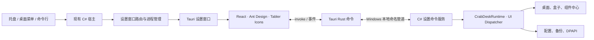

# CrabDesk 设置窗口迁移方案

2026-11-17 · 设计与实施计划

**目标**　将 Windows 版 CrabDesk 的设置窗口迁移到 Tauri 2、React + TypeScript、Ant Design 和 Tabler Icons，覆盖现有设置入口、即时生效和配置持久化。

**架构**　现有 C# 宿主管理桌面、托盘、系统集成和配置。Tauri 作为按需启动的独立设置窗口，通过本地命名管道读取设置、调用运行时方法、接收状态更新。先打通常规和外观，再逐页切换入口。

**当前阶段**　本文记录拟议实现。文中的新增文件、命令、路由和回退开关依实施批次交付。

## 1. 现状与迁移边界

| 当前职责 | 现有代码 | 迁移安排 |
| --- | --- | --- |
| 主应用启动、单实例和托盘命令 | [App.xaml.cs](../../../CrabDesk.WinUI/App.xaml.cs) 使用 `Local\CrabDesk.SingleInstance` 与命名事件 | C# 宿主继续接收托盘、桌面菜单、启动项和命令行请求，新加设置窗口的路由与进程管理 |
| 设置窗口和导航 | [MainWindow.xaml](../../../CrabDesk.WinUI/MainWindow.xaml)、[Views](../../../CrabDesk.WinUI/Views) | 按功能迁移到 React，保留各入口到具体页面的跳转 |
| 读写设置和触发刷新 | [ICrabDeskService.cs](../../../CrabDesk.WinUI/Services/ICrabDeskService.cs)、[CrabDeskService.cs](../../../CrabDesk.WinUI/Services/CrabDeskService.cs)、[CrabDeskRuntime.cs](../../../CrabDesk.Runtime/CrabDeskRuntime.cs) | 复用运行时方法。按页面定义可序列化的数据和命令，代替对 ViewModel 或 `CrabDeskState` 的进程内引用 |
| 小组件设置 | [WidgetsPage.xaml.cs](../../../CrabDesk.WinUI/Views/WidgetsPage.xaml.cs)、[CrabDeskRuntime.Widgets.cs](../../../CrabDesk.Runtime/CrabDeskRuntime.Widgets.cs) | 把编辑、预览和测试连接拆成独立命令。桌面卡片、组件中心及卡片内编辑保留原生实现 |
| Explorer 接管、盒子渲染、图标、全局热键、文件操作 | [CrabDesk.Runtime](../../../CrabDesk.Runtime)、[CrabDesk.Native](../../../CrabDesk.Native) | 继续由 C# 运行时执行。新设置页使用相同的操作结果和状态 |
| 原生独立窗口、桌面确认、亚克力工厂 | [App.xaml.cs](../../../CrabDesk.WinUI/App.xaml.cs)、[TodoDatesWindow.cs](../../../CrabDesk.WinUI/Windows/TodoDatesWindow.cs)、[WeatherDetailsWindow.cs](../../../CrabDesk.WinUI/Windows/WeatherDetailsWindow.cs) | 迁移设置页期间继续保留 WinUI 宿主、DispatcherQueue 和现有渲染工厂。独立窗口沿用当前生命周期 |
| 配置、备份和凭据 | [JsonLayoutStore.cs](../../../CrabDesk.Core/JsonLayoutStore.cs)、[JsonBackupService.cs](../../../CrabDesk.Core/JsonBackupService.cs)、[AiApiKeyStore.cs](../../../CrabDesk.Runtime/AiApiKeyStore.cs) | 继续使用现有目录、格式、迁移和 DPAPI。设置窗口通过调用运行时修改数据 |

第一批覆盖「常规」和「外观」，其中图标样式切换作为端到端验收项。待办日期、天气详情、浮动中转站和桌面文件确认是独立窗口，继续走现有原生入口。所有设置页切换后，如果还希望撤掉 WinUI 依赖，需另行迁移应用宿主、渲染工厂和这些原生窗口。

## 2. 进程与代码结构



建议把前端放在新的 `CrabDesk.Settings/`，保持现有项目及安装位置。新增部分按以下职责划分。

| 路径 | 职责 |
| --- | --- |
| `CrabDesk.Settings/src/app/` | 设置窗口布局、路由、主题、应用级状态提示 |
| `CrabDesk.Settings/src/pages/` | 按常规、外观、小组件等功能组织页面及局部状态 |
| `CrabDesk.Settings/src/ipc/settings.ts` | 类型化的 Tauri 调用、事件订阅、重连后同步 |
| `CrabDesk.Settings/src-tauri/src/settings_ipc.rs` | 管道连接、帧读写、响应匹配，将 C# 事件转发给前端 |
| `CrabDesk.Settings/src-tauri/capabilities/settings.json` | 设置窗口使用的权限声明 |
| `CrabDesk.WinUI/SettingsBridge/SettingsPipeServer.cs` | 管道服务、协议兼容、连接取消与请求校验 |
| `CrabDesk.WinUI/SettingsBridge/SettingsCommandHandler.cs` | 读取专用数据对象，通过 Dispatcher 调用既有设置方法 |
| `CrabDesk.WinUI/SettingsBridge/SettingsWindowLauncher.cs` | 路由分流、子进程启动、显示与激活、WinUI 回退 |
| `CrabDesk.Settings/contract/v1/` | 共享 JSON 协议样例，包括正常响应、错误、状态更新和非法输入 |

桥接层适合先放在当前宿主里，因为它已有适用的 Dispatcher 和设置服务。能够独立测试的帧解码、字段校验和 DTO 可放进 `CrabDesk.Core/SettingsProtocol/`，由 `CrabDesk.Tests` 覆盖；进程激活、窗口句柄和 Dispatcher 集成由 WinUI 测试及实机验证覆盖。

## 3. 打开、关闭与回退

1. C# 在初始化运行时后建立管道。继续通过 `ShowSettingsRequested` 和既有命名事件接收托盘、菜单、`--show-settings`、`--show-widgets` 和重复启动请求。第一次启动时，进入设置的路径也走同一个路由分流点。
2. 宿主根据已交付的页面选择前端。迁移第一批时，`general` 和 `appearance` 走 Tauri；其他入口继续打开对应 WinUI 页面。旧入口中的页签和小组件 ID 映射为明确的路由参数，不能解析时回到该功能首页。
3. 首次打开已迁移页面时，宿主启动一个设置进程并等待握手。握手完成后发送 `navigate`，由 Rust 显示窗口、申请激活并把目标路由转给 React。重复打开时复用存活的窗口和进程，启动期间的多次路由请求保留最后一次。以 Windows 实际前台策略验证从托盘打开、重复打开和最小化恢复。
4. 用户关闭设置窗口时，只结束设置进程，由宿主释放连接。托盘、桌面和配置保存继续工作。宿主退出或更新前通知设置进程退出并等待短时间回收，升级程序按原有流程替换文件。
5. 设置进程缺失、启动失败、握手超时或协议不匹配时，宿主打开对应 WinUI 页并记录简短原因。预发布保留显式的 `--legacy-settings` 回退入口，在已有宿主运行时也要通过单实例信号转发。回退只切换窗口，使用同一份已保存配置。

路由加入统一映射表后，托盘单击开启组件中心的现有行为仍由运行时决定，托盘里的「设置」以及桌面菜单的「外观」「小组件」再按映射打开对应设置页。

## 4. IPC 与状态同步

只使用本机命名管道。每次宿主启动生成新的管道名，通过进程参数传给设置进程；服务端使用 `PipeOptions.Asynchronous | PipeOptions.CurrentUserOnly`。Windows 下该选项同时校验用户和提升权限级别，因此安装结束后启动宿主和设置窗口应使用同一普通用户令牌。管道名不是认证凭据。宿主可校验连接的客户端 PID 是否属于实际启动的设置进程，以免同一用户会话内的其他客户端误连。 [Microsoft 命名管道选项](https://learn.microsoft.com/dotnet/api/system.io.pipes.pipeoptions)

v1 使用 UTF-8 JSON，每帧为 4 字节小端长度加正文，单帧限制 1 MiB。先校验长度再分配缓冲区。返回值带原请求 ID，事件独立发送。管道读写在线程池执行，读取运行时状态、校验后执行同步设置修改、构造修订号及快照由同一 Dispatcher 串行完成。长操作可通过进度事件更新页面，文件列表或日志量较大时分页。

| 消息 | 方向 | 约定 |
| --- | --- | --- |
| `hello` | 设置 → 宿主 | 协商协议版本，返回 `sessionId` 和可用路由；版本不兼容时结束连接并触发回退 |
| `settings.get` | 设置 → 宿主 | 返回当前设置快照和 `revision`，同时建立该连接的状态订阅 |
| `appearance.setIconSkinStyle` | 设置 → 宿主 | 验证风格值及 `expectedRevision`，调用 `SetIconSkinStyle`，返回权威值和修订号 |
| `settings.changed` | 宿主 → 设置 | 发送可订阅设置的最新快照。设置快照真正变化时才增加 `revision` |
| `navigate`、`shutdown` | 宿主 → 设置 | 路由跳转、显示或关闭窗口 |

第一批消息示例。字段采用 camelCase，外部枚举值使用显式字符串；C# 使用 DTO 和转换器映射到内部模型。

```jsonl
{"type":"request","id":"1","method":"hello","params":{"protocolVersions":[1]}}
{"type":"response","id":"1","result":{"protocolVersion":1,"sessionId":"session-example","routes":["general","appearance"]}}
{"type":"request","id":"2","method":"settings.get","params":{}}
{"type":"response","id":"2","result":{"revision":14,"general":{"themeMode":"system","launchToTray":true},"appearance":{"iconSkinEnabled":true,"iconSkinStyle":"flat","showShortcutArrow":true}}}
{"type":"request","id":"3","method":"appearance.setIconSkinStyle","params":{"style":"gradient","expectedRevision":14}}
{"type":"response","id":"3","result":{"revision":15,"iconSkinStyle":"gradient"}}
{"type":"event","event":"settings.changed","data":{"revision":15,"general":{"themeMode":"system","launchToTray":true},"appearance":{"iconSkinEnabled":true,"iconSkinStyle":"gradient","showShortcutArrow":true}}}
{"type":"response","id":"4","error":{"code":"revisionConflict","message":"设置已更新，请重新读取后再修改。","revision":15}}
```

- `settings.get` 的订阅和快照在同一 Dispatcher 操作内建立。前端先安装事件监听，再请求快照，在同一会话内忽略低于已应用修订号的数据。宿主重启生成新的 `sessionId`，前端丢弃旧会话缓存。
- 拖动滑块或输入文字时保留本地草稿，在提交或短暂防抖结束后发送更新。选择主题、图标风格等离散操作直接提交。请求在途时按控件合并最后一次值，旧响应不覆盖较新的草稿。
- 运行时使用现有保存调度。命令成功表示设置已在内存中应用并开始刷新，文件写入完成与否依现有持久化流程。退出时沿用正常保存；验收中覆盖改完即退出、重启后读回的场景。
- 断连时暂停提交，重新握手和获取快照。配置发生冲突时刷新并让用户确认当前值。整理、恢复备份和文件操作等有副作用的请求超时后，先查任务状态，避免自动重放。
- Rust 暴露命名明确的 Tauri 命令和数据结构，前端调用 `get_settings`、`set_icon_skin_style` 等命令。Capability 仅绑定设置窗口和实际使用的权限，生产构建加载随包分发的静态文件。通过既有 C# 服务打开外链、目录和安装器。 [Tauri 命令](https://v2.tauri.app/develop/calling-rust/) · [Tauri Capabilities](https://v2.tauri.app/security/capabilities/)
- AI 密钥只在用户提交替换值时传入。API 只返回凭据是否已配置等状态，保留 C# 的 DPAPI 存储。连接诊断记录请求类别和结果，避免把请求参数、磁盘路径列表、任务正文或密钥写到日志。

## 5. 页面与交互

设置窗口使用 Ant Design 的导航、表单、表格、分组、状态和确认控件。按系统、浅色、深色三种模式配置 `ConfigProvider`，中文日期和组件文案随应用语言配置。Tabler Icons 使用具名导入，导航、工具按钮和空状态沿用现有图标语义。图标按钮提供无障碍名称；开关和表单支持 Tab、Space、Enter，模态对话框关闭后焦点返回原入口。 [Ant Design 主题](https://ant.design/docs/react/customize-theme/) · [Tabler React](https://docs.tabler.io/icons/libraries/react)

| 功能 | 迁移内容 | 首要验收 |
| --- | --- | --- |
| 常规与外观 | 启动、隐藏文件和系统图标、动画、主题、盒子外观、图标套皮和箭头 | 从托盘打开新页，切换「柔光渐变」后桌面和盒子立即更新，重启后仍选中该风格 |
| 小组件 | 搜索和筛选、添加、尺寸与材质、显示器、桌面/组件中心迁移、组件特有设置 | 保留便签和待办内容，拖拽顺序和现有日期设置随原生组件继续工作。托盘或桌面菜单能跳到指定组件 |
| 桌面盒子与映射文件夹 | 创建、重命名、外观与视图、映射目录、只读和排序 | 文件夹由适当的原生文件选择器选择，错误路径有明确反馈，文件操作结果由运行时返回 |
| 快捷键 | 绑定、禁用、冲突反馈 | UI 显示实际注册结果，冲突时保留可恢复状态，重复录入未导致双重绑定 |
| 规则与智能整理 | 规则排序、预览、确认应用和撤销，AI 配置、测试连接、进度与取消 | 使用项目 ID 和预览版本提交；过期预览会重新生成，操作结果与桌面变化一致 |
| 备份、诊断和关于 | 计划备份、导入导出、迁移、诊断、版本和更新 | 备份可用当前版本恢复；导入、重置、更新仍由原有操作入口校验并执行 |

布局以左侧功能导航、右侧设置内容为主。采用 Windows 原生标题栏完成第一批迁移，窄窗口收起导航，并支持正常的键盘与窗口控制。以 100%、125%、150% 和双屏混合 DPI 检查字号、控件裁切、弹层定位和标题栏点击区。图标与设置预览优先复用运行时实际输出，保证 Steam 快捷方式及两套图标风格的页面预览与桌面结果一致。

## 6. 实施顺序

### 里程碑 A · 管道和常规/外观切片

- [ ] 建立 `CrabDesk.Settings/` 的 Tauri 2 + Vite + React TypeScript 项目，用 `package-lock.json` 和 `Cargo.lock` 固定依赖。加常规和外观路由、中文 Ant Design 主题与 Tabler 图标。
- [ ] 实现 v1 握手、`settings.get` 和 `appearance.setIconSkinStyle`。C# 从现有设置读值，调用 `SetIconSkinStyle`；Rust 读写管道，React 用响应回填下拉框。
- [ ] 把当前启动、二次启动和托盘的设置请求接入 `SettingsWindowLauncher`。按页启用迁移，支持新窗口启动失败时回到同一旧页。把二次打开、关闭设置、恢复最小化和退出宿主接到同一生命周期。
- [ ] 补齐两页其余开关、主题、颜色和数值。拿一份旧配置验证启用图标套皮、设置快捷方式箭头、切换图标样式以及重启后的读回。检查现有桌面接管、日期弹层和窗口焦点。

### 里程碑 B · 常用管理页

- [ ] 迁移小组件和盒子设置。为列表、编辑及预览定义独立的快照和命令，用稳定的组件/盒子 ID 调用既有方法，保留原生窗体的日期选择、天气和桌面交互。测试混合 DPI、盒子映射目录、组件迁移。
- [ ] 迁移快捷键、备份、诊断和关于。为更新下载、恢复/迁移和诊断进度定义操作 ID、取消与完成状态。验证取消操作、备份恢复及更新安装启动。

### 里程碑 C · 整理与正式切换

- [ ] 迁移规则与智能整理界面。使用现有的预览版本、选中项目 ID、确认、应用及撤销流程。验证慢响应、取消、版本失效、提交失败和历史保留。
- [ ] 完成安装、升级、托盘入口、混合 DPI 和回退测试，再把全部已验证设置路由切换到 Tauri。预发布保留 WinUI 设置入口用于回退，移除旧设置页面前确认各入口和独立原生窗口均已有对应路线。

## 7. 构建、安装与回退验证

沿用现有 [发布流程](../../RELEASING.md)、[publish.ps1](../../../build/publish.ps1)、[Inno Setup](../../../installer/CrabDesk.iss) 和 [在线安装器](../../../CrabDesk.Bootstrapper)。把 Tauri 产物作为同一个 win-x64 负载中的设置程序安装，例如 `{app}\settings\CrabDesk.Settings.exe`。安装快捷方式、开机启动和更新入口继续指向现有主程序，设置进程由宿主按需启动。

Windows 上使用系统 WebView2。当前依赖清单管理 .NET Desktop Runtime、Windows App Runtime 和 VC++ Runtime，加入 WebView2 检测后验证已安装、缺失和离线三种场景。在线安装器通过受校验的微软安装来源补齐缺失依赖，离线场景仍能进入 WinUI 回退页。发布作业固定 Node 和 Rust 工具链，使用锁文件构建，纳入现有签名策略及 Setup/Payload 完整性校验。 [Tauri Windows 前置依赖](https://v2.tauri.app/start/prerequisites/) · [WebView2 分发](https://v2.tauri.app/distribute/windows-installer/)

现有 C# 构建与测试可直接执行。桌面窗口相关的测试在登录的 Windows 会话内运行，保留当前 CI 对无桌面环境的分工。

```powershell
dotnet build CrabDesk.sln -c Release
dotnet test CrabDesk.Tests -c Release --no-build
dotnet test CrabDesk.Bootstrapper.Tests -c Release --no-build
dotnet test CrabDesk.WinUI.Tests/bin/Release/net8.0-windows10.0.19041.0/win-x64/CrabDesk.WinUI.Tests.dll -v minimal
```

新项目接入后，在 `CrabDesk.Settings` 目录内执行下列命令。由 npm 脚本跑前端类型检查与测试，Tauri CLI 仅构建程序，把最终封装交给现有安装链。 [Tauri CLI](https://v2.tauri.app/reference/cli/)

```powershell
npm ci
npm run typecheck
npm test
npm run tauri build -- --no-bundle --target x86_64-pc-windows-msvc
```

| 验证 | 可观察结果 |
| --- | --- |
| 协议和权限 | 正确版本成功连接；错误版本、长度超限、无效风格和其他用户连接得到明确结果；错误请求不修改设置 |
| 激活和恢复 | 托盘、命令行、桌面菜单打开目标页；重复点击只显示一个设置窗口；关闭窗口后托盘和桌面继续响应；断开连接时可回到旧页 |
| 即时刷新和持久化 | 修改主题、图标风格和箭头开关立即更新桌面与盒子；快速切换后最终状态正确；正常退出重启后读取到最后设置 |
| 升级和回退 | 使用隔离测试配置从现行版本升级，核对组件、盒子、规则、备份及密钥状态；禁用新设置入口后能用 WinUI 编辑同一份配置 |
| 视觉和输入 | 浅色与深色、窄窗口、混合 DPI、键盘导航、焦点返回及中文输入通过；控件不会被设置窗口或组件中心遮挡 |

图标切换验收使用包含桌面图标和盒子内快捷方式的测试布局。打开「启用图标套皮」，依次切换「macOS 扁平 → 柔光渐变 → macOS 扁平 → 柔光渐变」，检查两处都停在最后一次选择并保留 Steam 图标原图。退出和重开 CrabDesk，核对设置页下拉选项、渲染结果和旧配置中的其他外观字段。随后使用 WinUI 回退入口切回扁平，重新打开 Tauri 页面，确认读到同一份设置。

同一轮验证中分别模拟设置进程被关闭、管道握手失败和 WebView2 不可用。记录入口是否成功回退、宿主是否仍只有一个运行实例，以及再次打开设置后能否读到最新快照。设置页涉及删除盒子、恢复备份和整理应用的批次，需要通过其独立验收后才切换该路由。

开发和验证用隔离配置目录，避免覆盖日常桌面布局。现有 `CRABDESK_DATA_DIR` 可用于指定目录；验证时先退出同一登录会话内的 CrabDesk 实例，因为该变量与单实例互斥量相互独立。旧版与新版间回退优先用同一宿主内的 WinUI 入口，整包降级单独验证旧版可读性及备份恢复。
